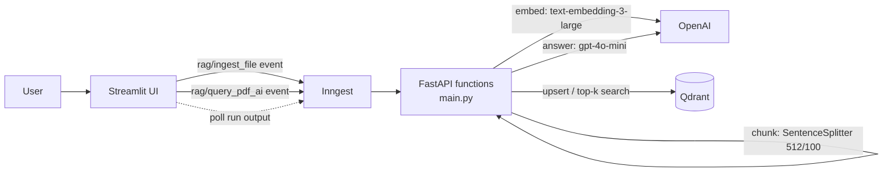

# PRAG: PDF question answering with a measured RAG pipeline

Upload PDFs, then ask questions about them. Answers come from the retrieved chunks only. When the PDFs don't contain the answer, the model says so instead of making one up. Chunk size and top_k were chosen from a labeled eval set, not by eye.

## Architecture



- **Ingest:** the PDF is saved, then split into 512-token chunks with 100-token overlap. Each chunk is embedded and upserted to Qdrant. Point IDs are deterministic, so re-uploading a file overwrites its chunks instead of duplicating them.
- **Query:** the question is embedded and the top 4 chunks are retrieved. `gpt-4o-mini` answers from those chunks.
- **Why Inngest:** each step (embed-and-search, LLM call) is retried and logged on its own. Queries are throttled per session (1 every 5 s) and rate limited per session (4 every 4 h).

## Setup

Requires Python 3.13, [uv](https://docs.astral.sh/uv/), Docker and Node (for the Inngest dev server).

```bash
uv sync
echo "OPENAI_API_KEY=sk-..." > .env

docker run -p 6333:6333 -v ./qdrant_storage:/qdrant/storage qdrant/qdrant   # terminal 1
uv run uvicorn main:app                                                      # terminal 2
npx inngest-cli@latest dev -u http://127.0.0.1:8000/api/inngest              # terminal 3
uv run streamlit run streamlit_app.py                                        # terminal 4
```

Open the Streamlit URL, upload a PDF, and ask a question. The Inngest dashboard at http://127.0.0.1:8288 shows each run step by step.

## Deploy (AWS)

The public demo runs on one AWS Lightsail server with Docker Compose. It runs four containers: FastAPI, self-hosted Inngest, Streamlit, and Caddy for HTTPS. Vectors live in Qdrant Cloud. Only Caddy is reachable from the internet. Uploads are turned off on the public server, so visitors can only ask questions about the preloaded documents.

1. **Create the server:** Lightsail → Create instance → Linux, Ubuntu 24.04, the 2 GB plan, region `us-east-1` (the same region as Qdrant Cloud). Attach a static IP. Under Networking, add a firewall rule for HTTPS (443).
2. **Install Docker:** SSH in from the Lightsail console, then run:
   ```bash
   curl -fsSL https://get.docker.com | sudo sh && sudo usermod -aG docker ubuntu && exit
   ```
3. **Get the code and add secrets:** reconnect, then:
   ```bash
   git clone <your-repo-url> prag && cd prag
   nano .env
   ```
   ```
   OPENAI_API_KEY=...
   QDRANT_URL=https://<cluster>.cloud.qdrant.io:6333
   QDRANT_API_KEY=...
   INNGEST_EVENT_KEY=<any random string>
   INNGEST_SIGNING_KEY=<output of: openssl rand -hex 32>
   SITE_ADDRESS=demo.yourdomain.com   # optional; omit to serve plain HTTP on the server's IP
   ```
   To get HTTPS, point the domain's DNS A record at the static IP first. Caddy then fetches a certificate automatically.
4. **Start it:**
   ```bash
   docker compose up -d --build
   ```
   To update later, run `git pull && docker compose up -d --build`.

Documents are loaded once from a local machine, with `QDRANT_URL` and `QDRANT_API_KEY` in the local `.env`: upload them through the local app.

## Evaluation

I tested 11 configurations on 28 labeled questions: 25 that the document answers and 3 that it doesn't. The configurations varied chunk size, top_k, and the amount of off-topic noise in the index. Full methodology, the bugs I found, and limitations are in [evals/RESULTS.md](evals/RESULTS.md).

| # | Chunk size / overlap | Chunks in index | Noise PDFs | top_k | Accuracy | Correct refusals | Retrieval hits | Avg latency | Cost per run |
|---|---|---|---|---|---|---|---|---|---|
| 1 | 1000 / 200 | 8 | no | 5 | **25/25** | 3/3 | 25/25 | 1.09s | $0.0156 |
| 2 | 1000 / 200 | 8 | no | 3 | 24/25 | 3/3 | 24/25 | 1.06s | $0.0095 |
| 3 | 1000 / 200 | 8 | no | 2 | 24/25 | 3/3 | 24/25 | 1.20s | $0.0065 |
| 4 | 256 / 50 | 31 | no | 2 | 22/25 | 3/3 | 21/25 | 1.17s | $0.0024 |
| 5 | 256 / 50 | 31 | no | 4 | 23/25 | 3/3 | 24/25 | 1.17s | $0.0042 |
| 6 | 256 / 50 | 31 | no | 5 | 23/25 | 3/3 | 24/25 | 1.11s | $0.0051 |
| 7 | 512 / 100 | 16 | no | 2 | 24/25 | 3/3 | 23/25 | 1.07s | $0.0038 |
| 8 | 512 / 100 | 16 | no | 4 | **25/25** | 3/3 | 25/25 | 1.14s | $0.0073 |
| 9 | 512 / 100 | 16 | no | 5 | **25/25** | 3/3 | 25/25 | 1.16s | $0.0090 |
| 10 | 512 / 100 | 45 | yes | 2 | 24/25 | 3/3 | 23/25 | 1.29s | $0.0038 |
| 11 | **512 / 100** | **45** | **yes** | **4** | **25/25** | **3/3** | **25/25** | **1.20s** | **$0.0073** |

Row 11 is the configuration the app ships with.

**What I learned**

1. **Chunks that are too large hide small facts.** At 1000 tokens, a two-sentence statistic shared a chunk with a page about another topic. It ranked 4th and was missed whenever top_k was under 4.
2. **Chunks that are too small break list answers, and those failures are worse.** At 256 tokens, the model gave confident wrong answers to questions that span a section, such as an invented list and a ladder with a rung missing. It didn't say the information was missing.
3. **512 tokens with top_k=4 was the best tradeoff:** 100% accuracy at 53% lower cost than the first perfect setup (row 8 vs row 1).
4. **Off-topic noise didn't affect retrieval.** Adding 3 unrelated PDFs nearly tripled the index with identical results (rows 7–8 vs 10–11).
5. **Every miss at 512 and 1000 tokens failed safely.** All 11 configurations refused 3/3 unanswerable questions.

Reproduce (needs Qdrant running with the source PDF ingested):

```bash
uv run python -m evals.test_run_eval   # grader unit test
uv run python -m evals.run_eval        # top_k=4; per-question results go to evals/results/
```
